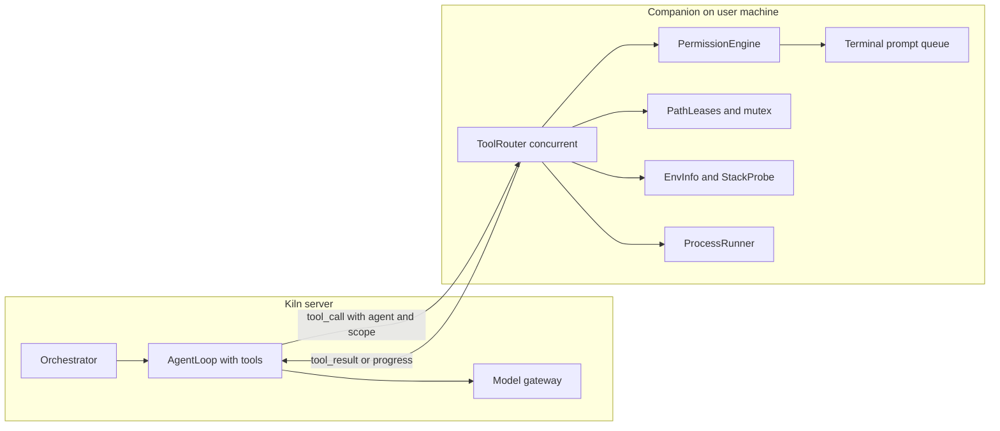

# Dev team on host: parallel devs, local environment, approvals

## What I found in Kiln today

**Dev agents**
- A "dev worker" is a single structured-JSON call, not an agent. [`src/kiln/agents/worker.py`](src/kiln/agents/worker.py) gets a task, the spec, the tests and its dependencies' files, and returns `WorkerResult`. It has no tool loop, cannot read the repo, and cannot run anything.
- `shell_command` is listed in [`src/kiln/agents/definitions.py`](src/kiln/agents/definitions.py) and `ShellCommand` exists in [`src/kiln/tools/schemas.py`](src/kiln/tools/schemas.py), but nothing implements them.
- Parallelism already exists mechanically. [`src/kiln/graph/orchestrator.py`](src/kiln/graph/orchestrator.py) runs `dependency_layers` with `asyncio.gather`, and `TaskGraph` rejects overlapping `owned_paths`.
- The gaps that let agents contradict each other:
  - Sibling workers in a layer never see each other's work, and there is no shared interface contract. Parallel tasks can disagree on routes, imports and signatures.
  - Ownership is only checked after the model replies, not when files are written.
  - The fixer blames one task by string-matching test ids (`_blame`), so a bug across two tasks cannot be fixed.
  - There is no integration check between "workers done" and "tests run".

**Environment**
- Docker is mandatory. [`src/kiln/companion/cli.py`](src/kiln/companion/cli.py) exits if Docker is missing. [`src/kiln/sandbox/runner.py`](src/kiln/sandbox/runner.py) runs pytest with `--network none --read-only`.
- Dependencies are vendored as manylinux wheels (`vendor_deps` in [`src/kiln/companion/executor.py`](src/kiln/companion/executor.py)). The whole flow is Python and pytest only.
- There is no host shell, no OS or shell awareness, no stack detection, and no install flow.
- The requirements agent is told "You cannot ask questions".
- The docs explicitly decided "shell never on host" and "Kiln runs unattended; allow/deny only" ([`docs/local-companion.md`](docs/local-companion.md), [`docs/agent-patterns.md`](docs/agent-patterns.md)). This plan reverses both decisions on purpose.

**Gateway**
- [`src/kiln/gateway/client.py`](src/kiln/gateway/client.py) only accepts string messages and has no `tools` parameter. `_validate_messages` rejects the tool role, so an agent loop cannot run yet.
- Muse Spark tool calling was already probed and works (`scripts/probe_spark.py`, `tool_choice=auto` only).

## What OpenCode does that we should copy

All paths are under `anomalyco/opencode`, `packages/core/src/`.

- **Permission engine** (`permission.ts`):
  - Rules are `{action, resource, effect: allow|ask|deny}` and the last matching rule wins.
  - An `ask` parks a pending request until the user replies `once`, `always` or `reject`.
  - A reject can carry feedback that goes back to the model as a normal tool error, so the agent adapts instead of dying.
  - Saved `always` rules are per project.
- **Shell tool** (`tool/plugin/shell.ts`):
  - The tool description names the OS and shell: "Commands run on Windows using pwsh".
  - It has `workdir`, `timeout` and `background` parameters.
  - Output is truncated.
  - It sets `AGENT=1` in the environment.
  - It runs a permission check before spawning.
- **Shell selection** (`shell/select.ts`):
  - On Windows it tries pwsh, then powershell, then Git Bash, then cmd.
  - On macOS it uses `$SHELL` or zsh. On Linux it reads `/etc/shells` and falls back to bash or sh.
  - Per-shell argument builders: `cmd /c`, PowerShell `-NoProfile -NonInteractive -Command`, and `-c` for POSIX shells.
- **Command parsing** (`shell/parse.ts`):
  - Compound commands are split into separate permission resources.
  - An arity table turns `npm run dev` into the reusable pattern `npm run *`.
  - `cd` targets are checked as directories.
  - Commands the parser cannot analyze are escalated, not guessed.
- **External directory guard** (`file-access.ts`): any path outside the workspace needs its own approval.
- **Per-path mutex** (`file-mutation.ts`): edits to the same file are serialized.
- **Subagents** (`tool/plugin/subagent.ts`):
  - Each runs in a child session with fresh context and a depth limit.
  - There is a background mode with completion notification.
  - The parent is told not to touch the same files a running subagent is using.
  - Spawning is itself permission-gated.
- **Web tools** (`websearch.ts`, `webfetch.ts`): both are permission-gated, and the first use asks the user to allow it. There is also a `question` tool for asking the user mid-run.
- **Declarative agents**: each agent is data, with mode, steps, permissions and model. Kiln already mirrors this in `definitions.py`.

Not copied: Effect/Layer, SQLite sessions, child-session resumability, and the TUI.

## Target architecture

The agent loop stays server-side, so the API key never leaves the server. Every tool call still goes through the existing WebSocket relay, and the companion on the user's machine is the trust root. Approvals are answered only in the companion terminal. The web floor shows a read-only "waiting for your approval" state.

## Phase 1: Agent loop with real tools (server)

- **Gateway**
  - Extend `Gateway.complete` with an optional `tools` argument, and let `Completion` carry `tool_calls`.
  - Allow assistant `tool_calls` and `tool` role messages in `_validate_messages`.
  - Keep `tool_choice="auto"`.
- **New `agents/loop.py`**
  - `run_agent_loop(role, messages, tools, max_steps)`.
  - At the step cap, inject the existing max-steps handoff (tools off, structured status).
  - Add a doom-loop guard that stops after 3 identical calls.
  - Every call goes through the budget guard.
  - The loop ends on a `submit_result` tool whose payload still validates as `WorkerResult` or `FixPatch`. The existing contracts are kept.
- **Tool set** in `tools/schemas.py`: `read_file`, `list_dir`, `glob`, `grep`, `write_file`, `edit_file`, `shell`, `ask_user`, `web_search`, `web_fetch`, `list_peers`, `submit_result`. Give each role a small subset, because many tools degrade tool-calling reliability.
- **Roles**: `RoleDefinition` gains a `permissions` ruleset, so the tool lists above become declarative.

## Phase 2: Local environment in the companion (replaces Docker-first)

- **Concurrent dispatch.**
  - `companion/client.py` handles calls serially today. Dispatch each `tool_call` as a task so two agents can work at once.
  - Add a `ToolProgress` message from companion to server. While a prompt is waiting for the user, it resets the server's call timeout (the relay uses 120 to 300 seconds today).
- **`companion/shellenv.py`** (port of `ShellSelect`):
  - Detect the OS, the shell, architecture, home directory, and which package managers and runtimes are on PATH.
  - Send this in `Hello.environment`, and inject it into every agent's system prompt: "Windows, PowerShell 7".
- **Per-OS command knowledge.** Add `agents/prompts/shell_windows.txt`, `shell_posix.txt` and `shell_macos.txt`. They cover:
  - PowerShell versus bash equivalents.
  - `&&` not working in Windows PowerShell 5.
  - Venv activation (`.venv\Scripts\Activate.ps1` versus `source .venv/bin/activate`).
  - `py` versus `python3`.
  - `npm.cmd`.
  - Quoting.
  - A "prefer dedicated tools over shell" rule, like OpenCode's `meta.txt`.
- **`companion/process.py`** runs commands with:
  - A workdir pinned to the workspace.
  - A default timeout of 120s.
  - A truncated output cap.
  - Process-tree kill.
  - A background mode for dev servers.
  - An environment scrubbed of secrets.
  - `AGENT=1` set.
- **Docker becomes optional.**
  - Add `--sandbox host|docker` with host as the default.
  - Remove `_check_docker` as a hard requirement.
  - Keep `sandbox/runner.py` as the opt-in backend.
  - Drop `vendor_deps`.

## Phase 3: Permissions and approval of every command (companion terminal)

- **`companion/permissions.py`**: `Rule` and `Ruleset` with last-match-wins evaluation and per-role defaults.
  - `read` inside the workspace is allowed. `.env*` is ask.
  - `write` and `edit` are allowed only inside the agent's owned paths, and denied elsewhere.
  - `shell`, `install`, `web_fetch`, `web_search` and `external_directory` are always ask.
  - A destructive denylist (recursive delete at root or home, disk format, and similar) is always deny.
- **`companion/commandscan.py`** splits compound commands (`;`, `&&`, `|`, redirects, `$()`) into separate lines for the prompt. For PowerShell and POSIX it keeps an arity table, as in `parse.ts`. A command it cannot parse is shown raw and can never be remembered.
- **`companion/prompt.py`** is a single prompt queue, so two agents never interleave questions.
  - It shows the agent name, the exact command, the shell and the workdir.
  - Replies are `y` (once), `n`, or `n` with feedback text, which goes back to the model as a tool error.
  - `a` (allow for this run) is offered only for exact, low-risk commands such as the test command. It is never offered for install, network or destructive commands.
  - Without a TTY, everything is denied.
- **Ownership audit for shell writes.** Hash the workspace before and after each shell command. Report any changed file outside the agent's lease to the user and the orchestrator.

## Phase 4: Requirements Q&A, stack check, install prompts

- **Requirements agent asks questions.** `requirements.run` becomes a short turn-based loop. Each turn returns either `questions[]` (a few multiple-choice items plus free text) or the `Spec`. Cap it at 2 rounds and about 5 questions.
  - For "todo app", it asks about API only versus UI, persistence, accounts, and a preferred language.
  - Questions are answered through the `ask_user` relay in the companion terminal.
  - Update `requirements.txt` to remove "You cannot ask questions".
- **`stacks/profiles.py`**: a `StackProfile` has detect, min version, install, test and run commands, the JUnit reporter flag, and per-OS install hints.
  - Ship `python` (pytest, venv in `.venv`) and `node` (Node 20 or later, npm, vitest with the junit reporter).
  - Add `Spec.stack_id`.
- **Stack resolver step** between the spec and the planner. The companion probes with fixed read-only version commands (`python --version`, `node --version`, `git --version`), shown as one batched approval. For each missing tool the user gets Allow or Deny to install, with the exact command for their OS (`winget install ...`, `brew install ...`, `apt ...`).
  - After an install, re-probe. On Windows, PATH changes may need a fresh shell. The companion should respawn its shell, or tell the user to re-run.
  - If the user denies, ask them to pick an alternative stack they already have, or end honestly.
- **`install_deps`** replaces `vendor_deps`. It runs `pip install -r` into the workspace `.venv`, or `npm install`, with approval each time.
- **`test_author` and the reporter** become profile-aware (pytest versus vitest). `sandbox/parser.py` already parses JUnit, so check it against vitest output.

## Phase 5: Two dev agents that cannot override each other

Prevention first, detection second.

1. **Contract first.**
   - The planner emits a `contract` (routes with request and response shapes, module public signatures, file names) and a layer-0 scaffold task.
   - The scaffold task owns the shared files (`requirements.txt`, `package.json`, the app entry point) and writes stubs that match the contract.
   - Parallel devs start only after scaffold, and each receives the contract as read-only context.
2. **Leases enforced at write time.**
   - The companion keeps a table of `{path prefix to agent id}`, built from `owned_paths`.
   - Every `write_file`, `edit_file` and shell write is checked against it.
   - A denied write returns an actionable error: "owned by worker-2 (task X); record a gap or message them".
3. **Safe concurrent edits.**
   - Add a per-path async mutex (like `FileMutation`).
   - Add read-before-write tokens: `edit_file` fails if the file changed since the agent last read it.
   - Install commands (`pip install`, `npm install`) take a global exclusive lock. Tests and reads run in parallel.
4. **Peer visibility.**
   - Add a read-only `list_peers` tool showing tasks, owners, status and files written so far, so devs code against real signatures.
   - Reads of any workspace file are allowed.
   - Peer messages show up on the floor as `MessageSent`.
5. **Parallelism limit.** Add `max_parallel_devs` (default 2) in `config.py`. The orchestrator throttles `_run_layer` with a semaphore. Tasks are not split further than needed.
6. **Integration gate.**
   - After each layer, run a contract-conformance check (import smoke test, route listing, or `tsc`) before the real tests.
   - Fix `_blame`: map a failing test id to criterion to task via the suite's `covers` data, instead of string matching.
   - The fixer runs when no devs are active, with its scope set to the union of the implicated tasks' paths.

## Phase 6: Web search and fetch

- `web_fetch` runs on the companion over the user's network. It asks the first time, caps response size, converts HTML to markdown, and marks content as untrusted, using the existing quote-as-data rule.
- `web_search` uses a pluggable provider with approval on first use, like OpenCode's. Use a no-key hosted search endpoint if one is available at implementation time (OpenCode uses Exa/Parallel MCP), with a simple HTML-search fallback. Confirm availability early, since this is the most uncertain part.
- Only requirements and dev roles get these tools.

## Phase 7: Protocol, events, UI

- **`companion/protocol.py`**
  - `Hello.environment`.
  - `ToolCall.agent` and `ToolCall.scope`.
  - `ToolProgress` message.
  - New denied and feedback result codes.
- **`events/schema.py`**: add `ApprovalPending` and `ApprovalResolved` as read-only floor events, with no command secrets. Show a "waiting for your approval in the terminal" badge in the `ui/` floor.
- **`main.py`**: `/companion/ws` handles `ToolProgress`.

## Phase 8: Tests and docs

- **Unit tests:**
  - Permission engine (last-match-wins, deny precedence).
  - Shell selection with a monkeypatched platform for Windows, macOS and Linux.
  - Command scanner (compound, substitution, opaque).
  - Lease table and mutex, including the case where two agents write overlapping paths and the second is denied.
  - Read-before-write token.
  - Agent loop with a fake transport (tool turns, step cap, doom loop).
  - Stack probe with a fake `which`.
  - Approval prompt with injected IO (once, deny with feedback, non-TTY deny).
- **Concurrency integration test** with two fake dev agents and a fake gateway. Extend `scripts/smoke_companion.py`.
- **Docs:** add `docs/dev-environment.md`, update `README.md`, `docs/local-companion.md` and `docs/agent-patterns.md` to record the reversed decisions, and update the `evals/` golden prompts to run on host.

## Cut line

The freeze is Nov 3. If time is short, ship in this order, since each step stands alone:

1. Phases 1 and 3 with `shell` and `edit_file` for a single dev.
2. Phase 5 leases and the contract.
3. Phase 2 OS and shell detection.
4. Phase 4 stack check and install prompts.
5. Phase 6 web tools.

## Risks to watch

- **Tool-calling reliability.** Muse Spark may be less reliable with many tools, so keep per-role tool lists small and validate `submit_result` strictly.
- **Windows specifics.** PowerShell quoting, PATH not refreshing after an install, and long-path edge cases.
- **Secrets.** `.env` reads ask, and shell commands run with a scrubbed environment.
- **Prompt injection.** Web content and repo files are untrusted. Per-command approval is the real defense, so never offer a blanket auto-approve.
- **Prompt fatigue.** Allow-for-this-run on exact low-risk commands keeps the fix loop usable without weakening approval for installs or network access.